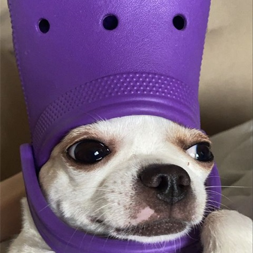

<p align="center">
  
</p>

<h1 align="center">MemeDrop</h1>

<p align="center">
  <b>Balance un meme sur Discord, il s'affiche sur l'écran de tous tes potes.</b><br />
  Par-dessus leurs jeux, leurs vidéos, tout. Instantanément.
</p>

<p align="center">
  <a href="https://memedrop.57-131-40-94.sslip.io/">📥 Télécharger</a> ·
  <a href="#-héberger-ta-propre-instance">🛠️ Héberger ta propre instance</a>
</p>

---

## ✨ C'est quoi ?

MemeDrop est une petite app Windows qui tourne discrètement dans la barre des tâches.
Quand quelqu'un poste une image, un GIF ou une vidéo dans un salon Discord relié à MemeDrop, ça **pop en overlay** sur l'écran de tous ceux qui ont l'app, avec le pseudo et l'avatar de l'auteur.

- 🖼️ **Images, GIFs, vidéos, sons**, envoyés en pièce jointe ou en lien
- 🎬 **TikTok, YouTube (Shorts inclus), Twitter/X, Instagram** : on colle le lien, la vidéo se lance
- 🎮 **Par-dessus tout**, même en jeu plein écran
- 🔊 **Volume, mute, et réception on/off** depuis l'icône de la barre des tâches
- 🖥️ **Choix de l'écran et de la position** (multi-écrans), opacité réglable
- 📚 **Bibliothèque** de tous les memes déjà passés, avec favoris, pour les renvoyer en un clic
- 🔄 **Mises à jour automatiques**

## 🧩 Comment ça marche

```
  Discord                       Serveur MemeDrop                  L'app chez tes potes
┌────────────┐   message    ┌────────────────────────┐   live   ┌──────────────────────┐
│  #memes    │ ───────────▶ │ Bot Discord + relais   │ ───────▶ │ Overlay par-dessus   │
└────────────┘              └────────────────────────┘          │ tout l'écran         │
                                                                └──────────────────────┘
```

Un **bot Discord** écoute les salons reliés à MemeDrop et transmet chaque meme aux apps connectées.
Chaque salon a un **code** (par exemple `lycee2025`) : c'est tout ce dont tes potes ont besoin pour le rejoindre.

## 🚀 Utiliser MemeDrop

1. **Télécharge et installe** l'app depuis le [site de téléchargement](https://memedrop.57-131-40-94.sslip.io/).
2. Au premier lancement, choisis **Rejoindre un salon** et entre le code qu'on t'a donné.
3. C'est prêt. L'app se range dans la barre des tâches (près de l'horloge) et se lance avec Windows.

Tu peux rejoindre plusieurs salons, et en ajouter ou en retirer à tout moment dans la fenêtre principale.

### 💬 Commandes Discord

À taper à la fin de ton message dans le salon :

| Commande | Effet | Exemple |
|---|---|---|
| `:N` | Affiche le meme pendant **N secondes** (60 max) | `regarde ça :15` |
| `/N` | Démarre la vidéo à **N secondes** | `https://youtu.be/... /42` |
| `!!STOP` | Coupe le meme en cours (message seul) | `!!STOP` |

Les commandes se combinent : `trop drôle :20 /5`.

## 🛠️ Héberger ta propre instance

Tu veux MemeDrop pour ta bande, avec ton propre bot ? Forke le dépôt et suis le guide. Ton instance est indépendante : tu ne vois et ne gères que **tes** serveurs Discord.

### 1. Crée le bot Discord

1. Va sur le [Discord Developer Portal](https://discord.com/developers/applications) → **New Application**.
2. Onglet **Bot** → active **MESSAGE CONTENT INTENT**.
3. **Reset Token** → copie le token et garde-le secret.

### 2. Lance le serveur

Le serveur (dossier [`server/`](server/)) tourne sur n'importe quel VPS avec Node.js 20+. Le guide pas à pas (Oracle Cloud gratuit, systemd, Docker) est dans [server/README.md](server/README.md).

```bash
cd server
npm install
ADMIN_PASSWORD="un-mot-de-passe-long-et-unique" node server.js
```

> ⚠️ `ADMIN_PASSWORD` est **obligatoire** : sans lui, l'administration du serveur est désactivée.
>
> 💡 Installe aussi [yt-dlp](https://github.com/yt-dlp/yt-dlp) sur le serveur : il sert à récupérer les vidéos Instagram et de secours pour TikTok et Twitter/X.

### 3. Prépare l'app

En haut de [`src/main.js`](src/main.js), mets l'adresse de ton serveur :

```js
const DEFAULT_SERVER_URL = 'ws://ton-serveur:8787';
```

Puis construis l'installeur (voir [Développement](#-développement)) et partage-le.

### 4. Configure tout depuis l'app

1. Lance l'app → **J'heberge un serveur** → l'adresse de ton serveur + ton `ADMIN_PASSWORD`.
2. Le panneau **⚙ Gestion** s'ouvre :
   - **Changer le token du bot** → colle le token de l'étape 1 ;
   - **Inviter le bot sur un serveur Discord** → choisis ton serveur ;
   - dans la carte de ton serveur, choisis un channel → **Créer le salon**.
3. Donne le **code du salon** à tes potes. C'est parti 🎉

Le panneau Gestion s'ajoute à l'app normale (bouton ⚙ en haut) : tu continues à recevoir les memes comme tout le monde. Il liste tous les serveurs Discord où ton bot est présent, avec leurs salons et le nombre d'apps connectées.

## 💻 Développement

```powershell
npm install
npm start          # lance l'app
npm run build      # crée l'installeur dans dist/
```

Pour un serveur local : `cd server && npm install && ADMIN_PASSWORD=test node server.js`, puis dans l'app, l'adresse `ws://localhost:8787`.

Sur ce dépôt, chaque changement de version dans `package.json` poussé sur `main` lance automatiquement le build et la publication de l'installeur (GitHub Actions).

## 🗂️ Structure

| Chemin | Rôle |
|---|---|
| `src/main.js` | Cœur de l'app Electron : barre des tâches, fenêtres, connexion aux salons, mises à jour |
| `src/overlay.html` | L'overlay transparent qui affiche les memes |
| `src/user.html` | Fenêtre principale : salons, volume, écran, position |
| `src/admin.html` | Panneau Gestion : bot, serveurs Discord, salons |
| `src/welcome.html` | Écran du premier lancement |
| `src/library.html` | Bibliothèque des memes |
| `server/` | Bot Discord + relais temps réel |
| `site/` | Page de téléchargement |

## ❓ FAQ

**Le meme ne s'affiche pas ?**
Vérifie dans la fenêtre principale que le salon est bien « Connecté », et que « Recevoir les memes » est activé dans l'icône de la barre des tâches.

**Un lien Instagram s'affiche juste en texte ?**
Instagram bloque souvent les serveurs. Le serveur a besoin de yt-dlp à jour, et ça peut quand même échouer de temps en temps.

**Ça marche sur Mac ou Linux ?**
Pas pour l'instant : l'app est pensée et testée pour Windows.
